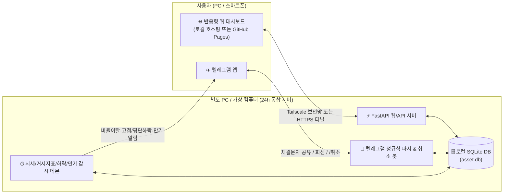

# AssetFlow: 다차원 자산관리 & 텔레그램 연동 리밸런싱 시스템 개발 계획 (`plan.md`)

## 1. 프로젝트 개요
본 프로젝트는 개인의 다중 계좌 금융자산을 통합 관리하고, 복수의 목표 자산비율 기준(위험/안전, 통화별, 국가별, 만기고정/유동성, 계좌별)에 따른 이탈 수준 진단, 시계열 추이 시각화, 상시 시장 감시 및 텔레그램 양방향 연동(정규식 기반 체결문자 파싱·회신·취소)을 제공하는 **로컬 서버 완결형 웹 애플리케이션**입니다.

---

## 2. 핵심 요구사항 정리

### 2.1 자산 및 다중 계좌(Multi-Account) 관리
- 초기 보유 자산 등록 시 실시간/주기적 금융자산 시세 및 환율을 반영하여 평가금액과 자산비율을 자동 계산.
- **동일 종목의 다중 계좌 분리·통합 관리**: 예를 들어 `삼성전자(005930)`를 미래에셋(일반위탁), 한국투자(연금저축), 토스증권(ISA) 등 여러 계좌에 나누어 보유한 경우, **종목 전체 합산 수량/가중평균단가/총평가액**과 **개별 계좌별 수량/평단가/수익률**을 동시에 관리(클릭 시 아코디언 펼침).

### 2.2 다차원 목표자산비율 & 100% 통합 막대그래프 & 추이 차트
- **복수 기준(5대 차원) 목표비율 관리**:
  1. 위험자산 vs 안전자산 비중
  2. 통화별 자산 비중 (KRW, USD 등)
  3. 국가별 주식 비율 (미국주식, 한국주식 등)
  4. 만기 고정 자산 vs 유동 자산 비중
  5. 주식/금융 계좌별 자산 비율
- **100% 누적 막대그래프 (Single Stacked Bar)**: 각 기준 내 구성 항목들의 합계가 100%가 되도록 단일 막대그래프 안에 분할 표시하고, 바로 아래 100% 목표 비중 막대와 나란히 배치하여 이탈 수준($\Delta\%p$)과 리밸런싱 필요 여부를 직관적으로 안내.
- **클릭 연동형 시계열 추이 그래프**:
  - `총 평가 자산` 카드 또는 `100% 자산비중 막대그래프의 특정 구간(항목)`을 클릭하면 해당 자산군의 기간별 **평가금액(₩) 추이** 및 **목표선 대비 비중(%) 추이 그래프**를 즉시 렌더링.

### 2.3 최상단 거시경제/시장 주요지표 텍스트 바 (전일 종가 대비 등락률 표시)
- 대시보드 최상단에 복잡한 차트 대신 **간결한 텍스트 + `(전일 장종료 대비 등락률%)`** 형태로 표시:
  - **환율 (4종)**: 원/달러(USD/KRW), 엔화(JPY/KRW), 유로(EUR/KRW), 위안화(CNY/KRW)
  - **국채수익률 (5종)**: 미국채 10년, 미국채 30년, 한국 국고채 10년, 일본 국채 10년, 중국 국채 10년
  - **주요 지수 (4종)**: 나스닥(NASDAQ), 코스피(KOSPI), 코스닥(KOSDAQ), 니케이225(Nikkei)
  - **원자재 & 가상자산 (3종)**: KRX 금현물(1g, 원화), 비트코인(USD 달러 시세), 비트코인(업비트 KRW 원화 시세)

### 2.4 텔레그램 연동 (AI 없이 정규식 문자 파싱 + 확인 회신 + 취소/원장 보관)
- **주문체결 문자(SMS/카톡) 텍스트 파싱**: 유료 AI API를 사용하지 않고, 증권사/은행 체결 알림 문자를 텔레그램 봇으로 전달(Forward)하거나 단축 명령어를 입력하면 **정규식(Regex) 파서**가 `[계좌명, 거래구분(매수/매도/만기/예치), 종목명, 수량, 단가]`를 추출하여 DB에 즉시 반영.
- **반영 결과 회신 및 거래 취소(Rollback)**:
  - 정상 인식 여부를 확인할 수 있도록 반영 직후 거래 고유번호(`#TX-1001`)와 변경된 계좌 잔고/평단가를 텔레그램으로 회신.
  - 잘못 인식되었을 경우 텔레그램 회신 메시지의 **`[↩️ 거래 취소]` 버튼** 또는 `/취소 #거래번호` 명령어를 보내면 직전 수량과 평단가로 정확히 원상복구.
- **거래 내역 원장(Ledger) 영구 보관**: 구현 완료 시점 이후 텔레그램 및 웹에서 입력된 모든 거래 이력을 DB에 영구 보관하고 대시보드에서 조회/취소 가능.

### 2.5 별도 PC / 가상 컴퓨터 상시 감시 & 4대 자동 알림
- 별도 서버 PC(또는 VM)에서 백그라운드 데몬이 장중/상시 모니터링하다가 조건 도달 시 텔레그램 알림 발송:
  1. **자산 목표비율 이탈**: 설정한 허용 오차(예: $\pm 5\%p$) 이상 벗어난 기준 발생 시
  2. **고점(ATH / 52주 최고가) 대비 하락**: 특정 보유 자산이 고점 대비 $-X\%$ 이상 하락 시
  3. **현재 평단가 대비 하락**: 특정 보유 자산이 통합 평단가(또는 계좌별 평단가) 대비 $-X\%$ 이상 하락 시
  4. **예금 만기일 도래**: 정기예금/만기고정 자산의 만기 전(`D-7`, `D-3`, `D-Day`) 사전 알림

---

## 3. 시스템 아키텍처 및 보안 설계

### 3.1 왜 로컬 서버 PC (SQLite) 단독 구조인가?
- 별도 PC/가상 컴퓨터가 24시간 구동되므로 외부 클라우드 DB(Supabase, Google Sheets 등)에 금융 데이터나 계정 인증 정보를 맡길 필요가 없음.
- 모든 자산 데이터, 거래원장, 일별 스냅샷은 로컬 서버 PC 내부의 단일 파일 데이터베이스(`asset.db`, SQLite)에 안전하게 저장됨.

### 3.2 PC / 스마트폰 외부 접속 및 보안 대책
1. **방안 1 (가장 권장 - Tailscale 사설 보안망)**:
   - 로컬 서버 PC와 본인의 스마트폰/노트북에 무료 개인용 VPN인 `Tailscale`을 설치.
   - 공유기 포트포워딩 없이 본인 기기들만 접속 가능한 암호화 사설 IP(`http://100.x.x.x:8000`)로 언제 어디서나 대시보드 접속 가능 (외부 해킹 원천 차단).
2. **방안 2 (GitHub Pages 프론트엔드 + Cloudflare Tunnel 연동)**:
   - 기존에 익숙한 `https://<아이디>.github.io/asset` 정적 페이지를 대시보드 화면으로 활용하고, 로컬 서버 PC의 FastAPI 백엔드를 Cloudflare Tunnel(`https://`) + PIN/토큰 인증으로 연결.



---

## 4. 데이터베이스 스키마 설계 (SQLite)

1. **`accounts` (계좌 테이블)**
   - `id`, `broker_name` (미래에셋, 키움, 한투, 신한은행 등), `account_type` (일반위탁, 연금저축, ISA, 정기예금, CMA), `target_ratio` (계좌별 목표비중)
2. **`assets` (종목/자산 마스터 테이블)**
   - `ticker` (PK: `005930`, `NVDA`, `DEP-01`), `name`, `currency` (`KRW`/`USD`), `current_price`, `prev_close`, `high_price` (고점 대비 하락 감시용), `tag_risk` (위험/안전), `tag_country` (미국/한국/비주식), `tag_liquidity` (만기고정/유동성)
3. **`holdings` (계좌별 보유 잔고 테이블 - 다중 계좌 핵심)**
   - `id`, `account_id` (FK), `ticker` (FK), `quantity`, `avg_price`, `maturity_date` (예금 만기일), `alert_ath_drop_pct`, `alert_avg_drop_pct`
4. **`transactions` (거래 내역 원장 & 취소 롤백 테이블)**
   - `tx_id` (PK: `TX-1001`), `created_at`, `source` (`TELEGRAM`/`WEB`), `raw_message`, `account_id`, `ticker`, `tx_type` (`BUY`/`SELL`/`MATURITY`/`DEPOSIT`), `quantity`, `price`, `status` (`ACTIVE`/`CANCELED`), `prev_quantity_snapshot`, `prev_avg_price_snapshot`
5. **`dimension_targets` (다차원 목표비율 설정 테이블)**
   - `dimension_key` (`risk`, `currency`, `country`, `liquidity`, `account`), `category_name`, `target_pct`, `tolerance_pct`
6. **`daily_snapshots` (시계열 추이 그래프용 일별 기록 테이블)**
   - `snapshot_date`, `scope_key` (`TOTAL`, `위험자산 (주식)`, `달러 (USD)`, `미국주식` 등), `eval_amount_krw`, `weight_pct`
7. **`alert_logs` (알림 발송 이력 - 중복 알림 쿨다운 관리)**
   - `id`, `alert_type`, `target_key`, `triggered_value`, `sent_at`

---

## 5. 단계별 개발 일정 (Implementation Roadmap)

### Phase 1: 프로젝트 초기화 및 로컬 DB / 코어 엔진 구축
- `c:\cowork\asset` 내 Python 가상환경 및 FastAPI + SQLite(`SQLAlchemy`) 프로젝트 구조 생성
- 다중 계좌 가중평균 단가 계산, 5대 차원별 실시간 비중 집계, 거래 반영 및 역산 취소(Rollback) 트랜잭션 함수 구현
- 초기 보유 자산 입력용 시드(Seed) 스크립트 및 웹 설정 API 구현

### Phase 2: 거시지표(16종) & 보유종목 시세 수집 모듈 구현
- **거시지표 수집기**:
  - 환율 4종 (`USD/KRW`, `JPY/KRW`, `EUR/KRW`, `CNY/KRW`)
  - 국채금리 5종 (미국 10Y/30Y, 한국 10Y, 일본 10Y, 중국 10Y - Yahoo Finance / Investing / 네이버 채권 파싱)
  - 주요지수 4종 (나스닥, 코스피, 코스닥, 니케이225)
  - KRX 금현물 시세 및 비트코인 시세 (`BTC-USD` 및 업비트 Public API `KRW-BTC`)
- **종목 시세 & 고점(`high_price`) 자동 갱신**: 현재가가 기존 고점을 돌파하면 `high_price`를 자동 상향 업데이트하고, 일별 마감 시 `daily_snapshots` 테이블에 총자산 및 분류별 금액/비중 자동 저장.

### Phase 3: 텔레그램 정규식 파서 봇 & 상시 감시 데몬 구현
- **정규식(Regex) 파서**:
  - 주요 증권사(미래에셋, 키움, 한국투자, 토스, 삼성, NH 등) 체결 문자 패턴 매칭 규칙 구현
  - 파싱 성공 시 DB 반영 → 텔레그램 회신 메시지 발송 (인라인 `[↩️ 거래 취소]` 버튼 및 `/취소` 명령어 핸들러 연결)
- **4대 조건 감시 스케줄러 (`APScheduler`)**:
  - 장중 주기적(예: 1~5분)으로 ① 목표비율 이탈, ② 고점 대비 $-X\%$ 하락, ③ 평단 대비 $-X\%$ 하락, ④ 예금 만기 `D-7/D-3/D-Day` 점검 후 조건 충족 시 텔레그램 알림 발송 (동일 조건 하루 1회 알림 쿨다운 적용).

### Phase 4: 반응형 웹 대시보드 연동 및 배포 구성
- 샘플 대시보드(`sample_dashboard.html`)를 백엔드 REST API와 연결
- PC/스마트폰 반응형 UI 최적화 및 GitHub Pages 정적 배포(선택) 또는 로컬 서버 직접 서빙 구성
- 윈도우 시작 시 백그라운드 자동 실행 스크립트(`.bat` / 작업 스케줄러 등록 가이드) 제공

---

## 6. 폴더 구조 (예정)
```text
c:\cowork\asset\
├── plan.md                  # 본 개발 계획서
├── sample_dashboard.html    # 인터랙티브 샘플 대시보드 (단독 실행 가능)
├── backend/
│   ├── main.py              # FastAPI 서버 엔트리포인트
│   ├── database.py          # SQLite DB 연결 및 스키마 정의
│   ├── models.py            # 계좌, 종목, 보유잔고, 거래원장, 스냅샷 모델
│   ├── market_fetcher.py    # 16종 거시지표 및 한/미 주식·금·BTC 시세 수집기
│   ├── sms_parser.py        # AI 없는 정규식(Regex) 체결문자 파서 & 롤백 로직
│   ├── telegram_bot.py      # 텔레그램 양방향 봇 핸들러
│   └── monitor_daemon.py    # 비율이탈 / 고점·평단 하락 / 예금만기 상시 감시 데몬
└── frontend/                # 웹 대시보드 정적 파일 (GitHub Pages 호환)
```
